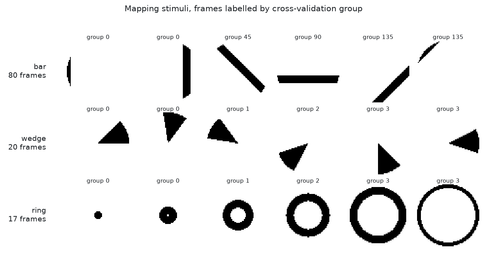

# CortexProbe

Fit 2D Gaussian receptive fields from aperture masks and frame responses.
Estimate the field and test predictions on held-out groups with Python, NumPy,
and SciPy. **Examples and recorded results are synthetic. No human-data or
neural-network evaluation.**

[](docs/figures/pipeline.png)

[Pipeline details](docs/pipeline.md) · [Editable SVG](docs/figures/pipeline.svg) · [Documentation](https://urmeo.github.io/cortexprobe/)

## Run

Use Python 3.9 or later. Run the example, check the recorded measurements, and
draw the plots:

```bash
git clone https://github.com/urmeo/cortexprobe.git
cd cortexprobe
python3 -m venv .venv
source .venv/bin/activate
python -m pip install -e '.[viz]'
python examples/fit_synthetic.py
python scripts/generate_validation_report.py --check
python scripts/generate_figures.py
```

Expected output for the noiseless synthetic example:

```text
center=(12.0, 8.0), sigma=5.0, accepted=True
held-out R²=1.000
```

Plots are saved in `docs/figures/`. [Usage](docs/usage.md) explains the inputs,
coordinates, bounds, and Python API.

## Watch the workflow

**Apertures and responses.** Moving bar, wedge, and ring masks sample a known
Gaussian field. The clean response follows their overlap. Each sequence uses its
own retained frames; playback shows sequence progress.

[](https://urmeo.github.io/cortexprobe/docs/media/#apertures-and-responses)

[Watch the video](https://urmeo.github.io/cortexprobe/docs/media/#apertures-and-responses) · [MP4 file](docs/media/aperture-response.mp4)

**Held-out prediction.** Four separate training-fold fits predict the excluded
group. This uses the field `(12, 8, 5)`, 20% Gaussian noise, and seed 7. Parameters
stay fixed during held-out prediction.

[](https://urmeo.github.io/cortexprobe/docs/media/#held-out-prediction)

[Watch the video](https://urmeo.github.io/cortexprobe/docs/media/#held-out-prediction) · [MP4 file](docs/media/grouped-validation.mp4)

See [video conditions and reproduction](docs/media/) for frame counts and
instructions to regenerate the clips with FFmpeg.

## From aperture to response

**Apertures.** Bar sweeps, rotating wedges, and expanding rings sample different
parts of the field. Frames carry group labels for validation.

[](docs/figures/stimuli.png)

**Forward model.** More overlap between the Gaussian and the aperture produces
a larger predicted response. Coordinates and width are in pixels.

[](docs/figures/model.png)

**Response curves.** This example uses the field `(12, 8, 5)`, 20% Gaussian noise,
and seed 7. It separates the full-data fit, held-out predictions, and residuals.

[](docs/figures/fitted-response.png)

## Recovery and uncertainty

The recovery experiment uses five known fields and one shared noise seed per
condition. Noise is measured relative to the clean response's standard deviation.
The largest observed error is specific to these five fits in one noise draw.

The recorded setup uses a 64 × 64 pixel field, 80 bar frames, four groups,
300 candidate fields, and sigma bounds of 1–10 pixels.

| Noise | Mean position error (px) | Largest position error (px) | Mean sigma error |
|---|---|---|---|
| None | 0.000 | 0.000 | 0.0% |
| 20% | 0.197 | 0.287 | 2.3% |
| 50% | 0.511 | 0.772 | 5.6% |

These are the five-field results with shared seed 7. A separate pure-noise check
accepted 0 of 40 response columns at seed 11 with an in-sample R² threshold of 0.2.
The [numeric record](results/validation.json) and
[validation report](docs/validation.md#recovery) retain the full results and provenance.

[](docs/figures/recovery.png)

The nominal 95% `x0` intervals covered the true value in 91.5–93.5% of trials
across the four recorded conditions. Each condition uses 200 trials; seeds are
paired across conditions. The intervals use a local approximation, and the
noiseless standard error is a numerical floor.

[](docs/figures/uncertainty.png)

## Autocorrelation and validation

**Noise curves.** White noise and width-3 moving-average noise are compared over
seeds 21–40. The autocorrelation plot shows sample curves and the stationary
reference for that noise generator.

[](docs/figures/noise-autocorrelation.png)

**Split comparison.** On correlated noise alone, random-frame R² minus grouped
R² was `+0.459 ± 0.402` across 20 seeds (mean ± SD). Both mean scores were
negative. A higher score from a random split can occur without a field signal.

[](docs/figures/leakage.png)

**Frame overlap.** This supplemental diagnostic compares cross-group cosine
similarity before and after grouping return sweeps together and pruning similar
frames. Aperture overlap is one source of dependence to check.

[](docs/figures/fold-leakage.png)

## Model limits

**Finite grid.** Sigma must be at least one pixel. The upper bound must retain
at least 99% of a centered Gaussian's sampled mass inside the circular field.
Fields near an edge can still lose mass. The plot illustrates these grid limits.

[](docs/figures/sigma-guard.png)

**Multiple lobes.** A single Gaussian can fit only part of a two-lobe response
and still pass the acceptance rules. The supplemental second-field diagnostic
measures remaining structure; it has no universal rejection threshold.

[](docs/figures/misspecification.png)

## Recorded runtime

These timings cover 1, 10, and 100 units on the recorded machine. Cross-validation
includes four training-fold fits and a full-data fit. The measurements are
hardware-specific; the report check preserves them without remeasuring time.

[](docs/figures/runtime.png)

[Validation tables and conditions](docs/validation.md) retain all numeric results,
seeds, uncertainty assumptions, historical runtimes, and limits.
[Figure details](docs/figures/) distinguish recorded results from seeded examples
and supplemental diagnostics.

## Files

| Folder | Contents |
|---|---|
| `src/cortexprobe/` | Apertures, Gaussian fitting, grouped validation |
| `examples/` | Runnable synthetic fitting example |
| `configs/`, `results/` | Experiment settings, numeric record, and measurement provenance |
| `docs/` | Guides, plots, videos, and site assets |
| `scripts/` | Report, plot, video, and documentation generation |
| `benchmarks/` | Measured runtime by unit count |
| `tests/` | Fitting, configuration, stimulus, and reporting checks |

[MIT license](LICENSE) · [Citation](CITATION.cff)
