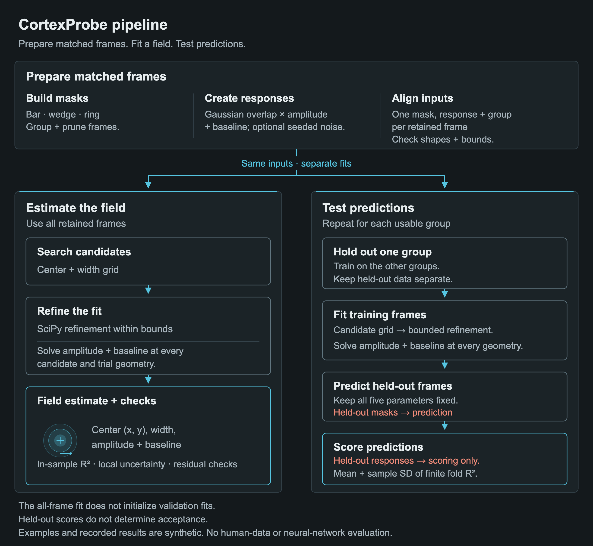
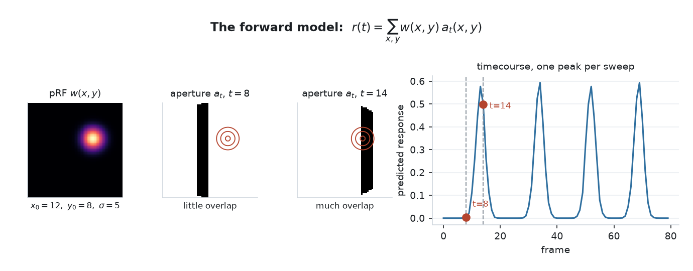
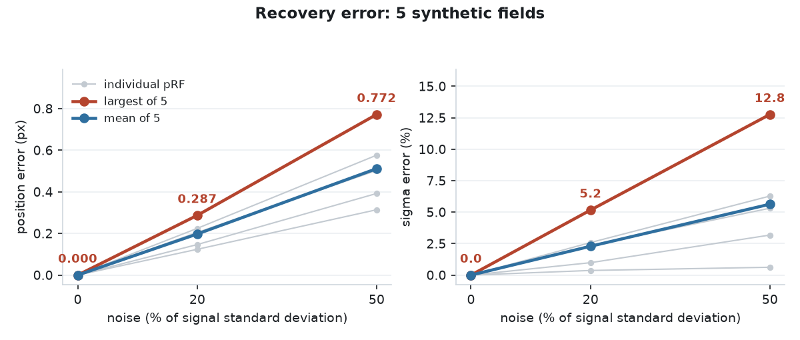
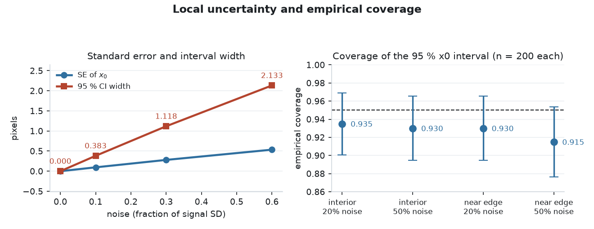
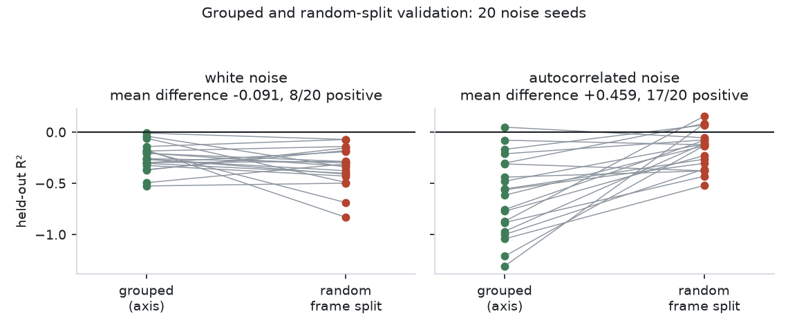
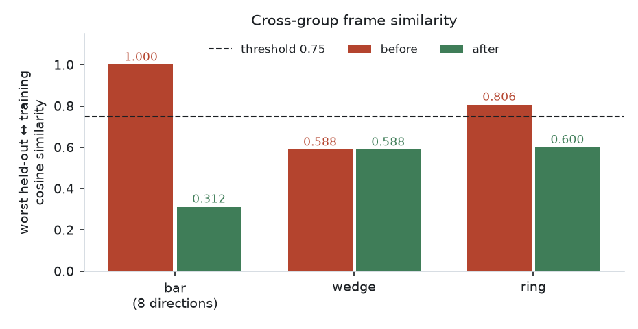
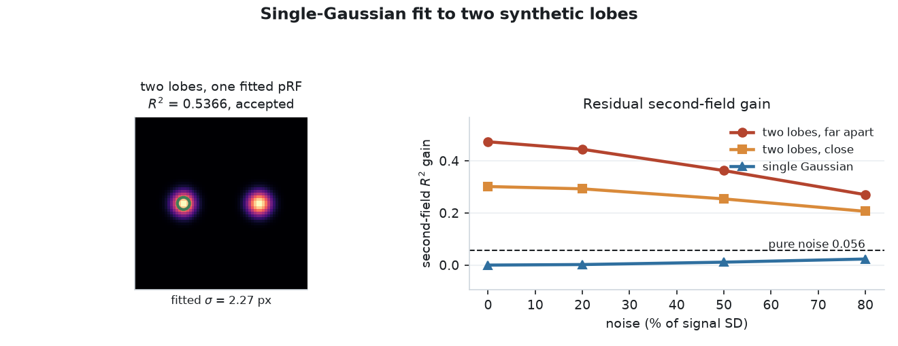

# CortexProbe

Fit 2D Gaussian receptive fields from aperture masks and frame responses.
Estimate the field and test predictions on held-out groups with Python, NumPy,
and SciPy. **Examples and recorded results are synthetic. No human-data or
neural-network evaluation.**

[](docs/figures/pipeline.png)

[Pipeline details](docs/pipeline.md) · [Editable SVG](docs/figures/pipeline.svg) · [Documentation](https://urmeo.github.io/cortexprobe/)

## Run

Use Python 3.9 or later.

```bash
git clone https://github.com/urmeo/cortexprobe.git
cd cortexprobe
python3 -m venv .venv
source .venv/bin/activate
python -m pip install -e '.[viz]'
python examples/fit_synthetic.py
python scripts/generate_validation_report.py --check
python scripts/generate_figures.py
```

Expected output for the noiseless synthetic example:

```text
center=(12.0, 8.0), sigma=5.0, accepted=True
held-out R²=1.000
```

Plots are saved in `docs/figures/`. See [Usage](docs/usage.md) for the Python API.

## Watch the workflow

**Apertures and responses.** Bar, wedge, and ring masks sample a known Gaussian field.

[](https://urmeo.github.io/cortexprobe/docs/media/#apertures-and-responses)

[Watch the video](https://urmeo.github.io/cortexprobe/docs/media/#apertures-and-responses) · [MP4 file](docs/media/aperture-response.mp4)

**Held-out prediction.** Four training-fold fits predict their excluded groups
without refitting. Synthetic response: field `(12, 8, 5)`, 20% Gaussian noise, seed 7.

[](https://urmeo.github.io/cortexprobe/docs/media/#held-out-prediction)

[Watch the video](https://urmeo.github.io/cortexprobe/docs/media/#held-out-prediction) · [MP4 file](docs/media/grouped-validation.mp4)

[Video conditions and reproduction](docs/media/)

## From aperture to response

**Forward model.** More overlap between the Gaussian and the aperture produces
a larger predicted response. Coordinates and width are in pixels.

[](docs/figures/model.png)

**Response curves.** This example uses the field `(12, 8, 5)`, 20% Gaussian noise,
and seed 7. It separates the full-data fit, held-out predictions, and residuals.

[](docs/figures/fitted-response.png)

## Recovery and uncertainty

| Noise | Mean position error (px) | Largest position error (px) | Mean sigma error |
|---|---|---|---|
| None | 0.000 | 0.000 | 0.0% |
| 20% | 0.197 | 0.287 | 2.3% |
| 50% | 0.511 | 0.772 | 5.6% |

[](docs/figures/recovery.png)

The nominal 95% `x0` intervals covered the true value in 91.5–93.5% of trials
across the four recorded conditions. Each condition uses 200 trials; seeds are
paired across conditions. The intervals use a local approximation, and the
noiseless standard error is a numerical floor.

[](docs/figures/uncertainty.png)

## Autocorrelation and validation

**Noise curves.** White and width-3 moving-average noise over seeds 21–40,
with sample autocorrelations and their stationary reference.

[](docs/figures/noise-autocorrelation.png)

**Split comparison.** On correlated noise alone, random-frame R² minus grouped
R² was `+0.459 ± 0.402` across 20 seeds (mean ± SD). Both mean scores were
negative. A higher score from a random split can occur without a field signal.

[](docs/figures/leakage.png)

**Frame overlap.** Cross-group cosine similarity before and after grouping
opposite sweeps and pruning similar frames. This checks mask overlap only.

[](docs/figures/fold-leakage.png)

## Model limits

**Finite grid.** Sigma must be at least one pixel. The upper bound must retain
at least 99% of a centered Gaussian's sampled mass inside the circular field.
Fields near an edge can still lose mass.

[](docs/figures/sigma-guard.png)

**Multiple lobes.** A single Gaussian can fit only part of a two-lobe response
and still pass the acceptance rules. The second-field diagnostic measures
remaining structure; it has no universal rejection threshold.

[](docs/figures/misspecification.png)

## Recorded runtime

Hardware-specific timings for 1, 10, and 100 units. Cross-validation includes
four training-fold fits and a full-data fit. The report check does not remeasure time.

[](docs/figures/runtime.png)

[Validation tables and conditions](docs/validation.md) · [Figure details](docs/figures/)

## References

Branch, M. A., Coleman, T. F., & Li, Y. (1999). A subspace, interior, and conjugate
gradient method for large-scale bound-constrained minimization problems.
*SIAM Journal on Scientific Computing, 21*(1), 1–23.
[https://doi.org/10.1137/S1064827595289108](https://doi.org/10.1137/S1064827595289108)

Dumoulin, S. O., & Wandell, B. A. (2008). Population receptive field estimates in
human visual cortex. *NeuroImage, 39*(2), 647–660.
[https://doi.org/10.1016/j.neuroimage.2007.09.034](https://doi.org/10.1016/j.neuroimage.2007.09.034)

Golub, G. H., & Pereyra, V. (1973). The differentiation of pseudo-inverses and
nonlinear least squares problems whose variables separate.
*SIAM Journal on Numerical Analysis, 10*(2), 413–432.
[https://doi.org/10.1137/0710036](https://doi.org/10.1137/0710036)

Kriegeskorte, N., Simmons, W. K., Bellgowan, P. S. F., & Baker, C. I. (2009).
Circular analysis in systems neuroscience: The dangers of double dipping.
*Nature Neuroscience, 12*(5), 535–540.
[https://doi.org/10.1038/nn.2303](https://doi.org/10.1038/nn.2303)

## License

[MIT](LICENSE)
